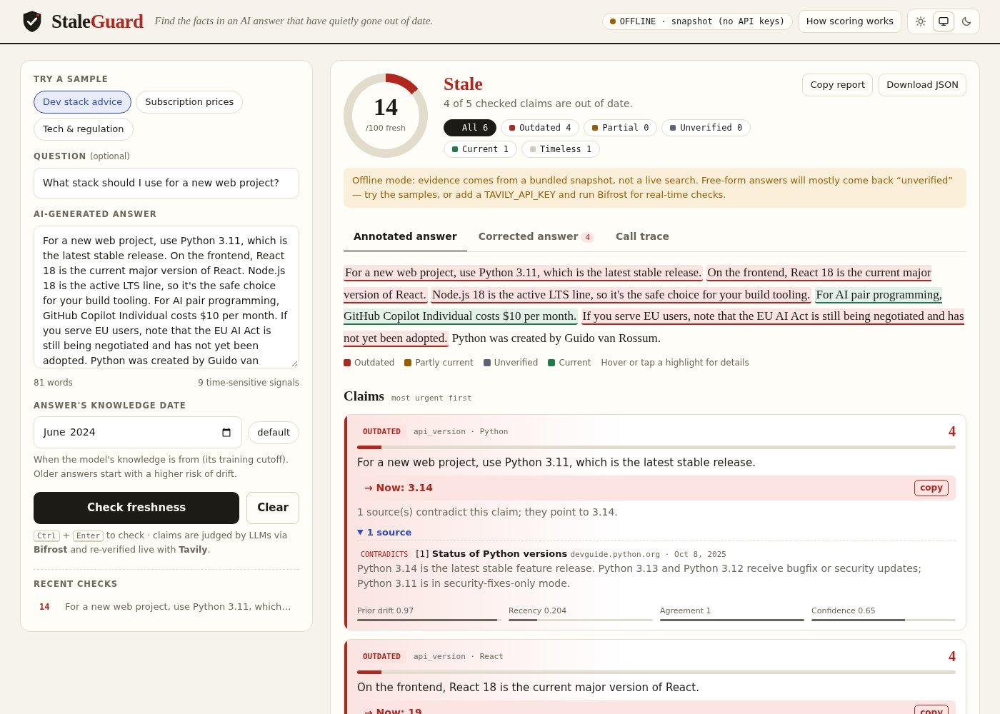

# StaleGuard — a stale-answer detector for AI applications

> **Global AI Hackathon (Geek Room) · Problem statement: _Build a Stale-Answer Detector for AI Applications_**
> Built with **Tavily** (live web re-verification) and **Bifrost by Maxim AI** (LLM gateway with fallbacks, virtual keys and budgets).

LLMs answer confidently from a frozen snapshot of the world. Prices change, libraries ship new majors,
laws pass, executives move on — and the answer still *sounds* right. StaleGuard takes any LLM-generated
answer, pulls out the claims that can go out of date, checks each one against the live web, and returns:

* a **freshness score (0–100) for every claim** and for the whole answer, with an explainable breakdown;
* a verdict per claim — **current / outdated / partially current / unverified / timeless**;
* the **up-to-date value** and the **sources** (with publish dates) that prove it;
* a **refreshed answer** with the stale parts corrected and cited.

It runs as a **web app**, a **REST API**, a **CLI** (with `--fail-under` for CI/eval pipelines), and as an
**OpenAI-compatible guarded endpoint** — point any OpenAI SDK at StaleGuard and every completion comes back
with a freshness report attached.



---

## Contents
- [Why this matters](#why-this-matters)
- [How it works](#how-it-works)
- [How Tavily and Bifrost are used](#how-tavily-and-bifrost-are-used)
- [The freshness score](#the-freshness-score)
- [Quick start](#quick-start)
- [Usage: UI, API, CLI, guarded endpoint](#usage)
- [Project structure](#project-structure)
- [Testing](#testing)
- [Limitations and next steps](#limitations-and-next-steps)
- [AI usage disclosure](#ai-usage-disclosure)

## Why this matters

| Who | What goes wrong today | What StaleGuard gives them |
|---|---|---|
| Support / sales chatbots | Quotes last year's price or plan name to a customer | Blocks or rewrites answers whose pricing claims fail re-verification |
| Developer assistants | Recommends EOL runtimes or old major versions | Flags `Node.js 18 is the active LTS` → **now 24**, with the release page as proof |
| Compliance / legal Q&A | Describes a regulation as "still being negotiated" after it passed | Detects the status change and cites the official source |
| RAG / eval teams | No metric for "is this answer still true?" | A per-claim freshness score usable as an eval metric or CI gate |

## How it works

```
                ┌──────────────────────────── StaleGuard ─────────────────────────────┐
 LLM answer ──► │ 1. Claim extraction        cheap model  ──► Bifrost ──► OpenAI / Anthropic / Groq
                │    (+ heuristic risk pre-pass: prices, versions, laws, roles, stats) │
                │                                                                      │
                │ 2. For each time-sensitive claim, in parallel:                       │
                │      Tavily search (recency-bounded, dated results) ──► evidence     │
                │      Adjudication   strong model ──► Bifrost (with fallbacks)        │
                │         verdict · current value · per-source stance · confidence     │
                │                                                                      │
                │ 3. Freshness scoring (deterministic, explainable)                    │
                │ 4. Refreshed answer with corrections + citations                     │
                └──────────────────────────────────────────────────────────────────────┘
                            │
                            ▼
      Web UI (annotated answer) · REST API · CLI · OpenAI-compatible guarded endpoint
```

1. **Claim extraction.** A heuristic pre-pass flags risky sentences (money amounts, version numbers,
   "latest/current/still", regulation and leadership vocabulary). The extractor model then splits the answer
   into atomic, self-contained claims with `category`, `subject`, `attribute`, `value`, the exact `span` in
   the answer, and a **search query that deliberately omits the asserted value** so the search isn't biased
   toward confirming it. Timeless facts ("Python was created by Guido van Rossum") are marked `stable` and
   skipped — no wasted searches.
2. **Live re-verification.** Each time-sensitive claim gets a Tavily search tuned to its category
   (news topic for company info, `start_date` windows for fast-moving categories, published dates always on).
   The judge model reads the numbered results, labels each source as supporting/contradicting/neutral, and
   returns a verdict, the current value and its confidence. It is told to prefer *unverified* over guessing.
3. **Scoring.** A transparent formula (below) turns verdict + evidence into a 0–100 score.
4. **Rewrite.** Outdated claims are corrected in place with inline citations.

**Resilience by design.** If every provider is down, StaleGuard still works: it falls back to a deterministic
judge (version/price/status comparison over the retrieved evidence). With no API keys at all it runs in
**offline mode** on a bundled snapshot corpus so anyone can try it in 30 seconds.

## How Tavily and Bifrost are used

**Tavily — the source of truth for "what's true now"**
- `POST /search` per claim, with `search_depth: advanced`, `include_published_date: true`,
  `chunks_per_source: 3` and a category-specific `start_date` window (e.g. 1 year for pricing and versions,
  2 years for regulation) so stale pages don't "confirm" stale claims.
- `topic: news` for company/leadership claims; `general` elsewhere.
- Published dates feed the **evidence-recency** term of the score.
- Results are cached per (query, category) to avoid paying twice for duplicate claims.

**Bifrost — every LLM call goes through the gateway** (`POST /v1/chat/completions`)
- **Model routing:** a cheap model (`openai/gpt-4o-mini`) for extraction and rewriting, a stronger one
  (`openai/gpt-4o`) for adjudication — configurable per env var, any provider Bifrost supports.
- **Automatic fallbacks:** every request carries a `fallbacks` list
  (`anthropic/claude-3-5-haiku-latest`, `groq/llama-3.3-70b-versatile`). A provider outage doesn't stop
  verification. Bifrost's `extra_fields.routing_info` is parsed so the UI's **call trace** shows which
  provider actually answered and whether a fallback fired.
- **Governance:** requests send a virtual key (`x-bf-vk`). The shipped `bifrost/data/config.json` scopes that
  key to just the models StaleGuard needs and attaches a **monthly budget** — so a verification service
  can't run up an unbounded bill.
- **Retries:** per-provider `network_config` with backoff.
- The **guarded endpoint** forwards the caller's own request to Bifrost, so apps keep all of Bifrost's routing
  while gaining freshness checks.

Provider API keys live only in Bifrost; StaleGuard never sees them.

## The freshness score

Each claim gets four transparent components (all shown in the UI):

| Component | Meaning |
|---|---|
| `prior_risk` | Chance the fact has drifted, **before** looking at evidence: `1 − 0.5^(age / half_life)` where age = today − the answer's knowledge date and half-life depends on category (pricing 120 d, versions 180 d, company info 240 d, statistics 365 d, regulation 540 d). |
| `evidence_recency` | `0.5^(age_of_newest_relevant_source / 180 d)` |
| `source_agreement` | Share of decisive sources that agree with the verdict |
| `confidence` | Judge confidence |

```
current     → (0.7 + 0.15·recency + 0.15·agreement) · (0.6 + 0.4·confidence)
outdated    → confidence · (0.05 + 0.15·(1 − agreement)) + (1 − confidence) · (1 − prior_risk) · 0.5
partial     → 0.5 · (0.6 + 0.4·confidence) + (1 − confidence) · (1 − prior_risk) · 0.2
unverified  → 0.2 + 0.5 · (1 − prior_risk)        # can't confirm ≠ wrong
timeless    → 1.0
```

The **answer score** is `0.6 · mean + 0.4 · min` over checked claims: one wrong price makes an answer unsafe
to act on, so a single stale claim drags the score down hard. Grades: **Fresh** ≥ 85 · **Mostly fresh** ≥ 65 ·
**Needs review** ≥ 40 · **Stale** < 40.

## Quick start

### 1. Try it with no keys (offline mode)
```bash
git clone https://github.com/ishan5608/staleguard && cd staleguard
pip install -r requirements.txt
STALEGUARD_MODE=offline uvicorn staleguard.server:app --port 8000
# open http://localhost:8000 → "Load demo" → "Check freshness"
```

### 2. Live mode (Tavily + Bifrost)
```bash
cp .env.example .env        # add TAVILY_API_KEY and at least one provider key (OPENAI_API_KEY, ...)

# start Bifrost with the bundled config (providers, fallbacks, virtual key + budget)
npx -y @maximhq/bifrost -app-dir ./bifrost/data
# or: docker run -p 8080:8080 -v $(pwd)/bifrost/data:/app/data --env-file .env maximhq/bifrost

uvicorn staleguard.server:app --port 8000
```

### 3. Everything with Docker Compose
```bash
cp .env.example .env && docker compose up --build
# StaleGuard → http://localhost:8000   Bifrost dashboard → http://localhost:8080
```

### Configuration
| Variable | Default | Purpose |
|---|---|---|
| `STALEGUARD_MODE` | `auto` | `live`, `offline`, or `auto` (live if `TAVILY_API_KEY` set) |
| `TAVILY_API_KEY` | – | Tavily key |
| `BIFROST_URL` | `http://localhost:8080` | Gateway URL |
| `BIFROST_VIRTUAL_KEY` | – | Sent as `x-bf-vk` (budgets / model allow-list) |
| `EXTRACT_MODEL` / `JUDGE_MODEL` | `openai/gpt-4o-mini` / `openai/gpt-4o` | Bifrost `provider/model` names |
| `LLM_FALLBACKS` | `anthropic/claude-3-5-haiku-latest,groq/llama-3.3-70b-versatile` | Fallback chain |
| `DEFAULT_KNOWLEDGE_DATE` | `2024-06` | Assumed knowledge date when the caller doesn't give one |
| `TAVILY_SEARCH_DEPTH`, `TAVILY_MAX_RESULTS`, `STALEGUARD_CONCURRENCY` | `advanced`, `5`, `4` | Search tuning |

## Usage

### Web UI
Paste an answer (optionally the question and the model's knowledge date). Claims are highlighted in place —
green current, red outdated, amber partial, grey unverified — click one to jump to its evidence, score
breakdown and sources. Below: the refreshed answer (copyable) and the call trace (which provider served
each LLM call, fallbacks, latency, tokens).

### REST API
```bash
curl -s localhost:8000/api/check -H 'content-type: application/json' -d '{
  "question": "Which Node version should I deploy?",
  "answer": "Node.js 18 is the active LTS line, so use it for production.",
  "knowledge_date": "2024-06"
}'
```
Returns `overall_freshness`, `grade`, per-claim `verdict` / `freshness` / `breakdown` / `current_value` /
`evidence[]`, `refreshed_answer`, `trace[]` and `stats`. Interactive docs at `/docs`.

### CLI (works as a CI / eval gate)
```bash
python -m staleguard.cli examples/demo_answer.txt -k 2024-06
python -m staleguard.cli answer.txt --json
python -m staleguard.cli answer.txt --fail-under 70   # exit 1 if the answer is stale
```

### OpenAI-compatible guarded endpoint
```python
from openai import OpenAI
client = OpenAI(base_url="http://localhost:8000/v1", api_key="unused")
r = client.chat.completions.create(
    model="openai/gpt-4o-mini",
    messages=[{"role": "user", "content": "How much does GitHub Copilot cost?"}],
    extra_body={"staleguard": {"knowledge_date": "2024-06", "replace_with_refreshed": True}},
)
print(r.choices[0].message.content)        # refreshed, cited answer
print(r.model_extra["staleguard"]["overall_freshness"])
```
The request is forwarded to Bifrost unchanged (fallbacks, virtual keys and all); the response also carries
`X-StaleGuard-Freshness` / `X-StaleGuard-Grade` headers.

## Project structure
```
staleguard/
  pipeline.py     orchestration: extract → verify (parallel) → score → rewrite
  llm.py          Bifrost client: fallbacks, x-bf-vk, routing-info parsing, robust JSON parsing
  search.py       Tavily client: category-aware recency windows, published dates, caching
  heuristics.py   model-free risk detection, claim splitting, version/price/status comparison judge
  scoring.py      explainable freshness score
  prompts.py      extraction / adjudication / rewrite prompts
  offline.py      snapshot search for keyless demo mode
  server.py       FastAPI: UI, /api/check, /v1/chat/completions guard
  cli.py          command line + CI gate
  static/         single-file web UI
  data/           offline snapshot corpus
bifrost/data/config.json   providers, retries, virtual key + budget
scripts/          build_deck.js (pitch deck), screenshot.py (README image)
tests/            unit + end-to-end tests (Bifrost and Tavily mocked at the HTTP layer)
docs/             screenshot, pitch deck (StaleGuard_pitch.pptx)
```

## Testing
```bash
pip install -r requirements-dev.txt && pytest -q
```
19 tests cover classification, value extraction, version/price contradiction logic, scoring monotonicity,
the offline demo end-to-end, and the **live pipeline against HTTP-level mocks of Bifrost and Tavily** —
asserting every LLM call hits `/v1/chat/completions` with the virtual key and fallback chain, that Bifrost's
fallback routing info reaches the trace, that Tavily gets bearer auth + recency filters, and that the system
degrades gracefully to heuristics when all providers return 503. GitHub Actions runs them on every push.

## Limitations and next steps
- Offline mode's snapshot corpus is small and dated (captured late 2025) — it exists so the demo runs without
  keys; live mode is the real product.
- Claims that need reasoning over many sources (e.g. market share) are harder to adjudicate; the judge is
  instructed to return *unverified* rather than guess.
- Next: streaming per-claim results to the UI, a Bifrost plugin so the guard runs inside the gateway itself,
  domain allow-lists per category (official docs for versions, government sites for regulation), and
  freshness-over-time dashboards for a deployed chatbot's answers.

## AI usage disclosure
AI is central to the product (LLM claim extraction, adjudication and rewriting via Bifrost). AI coding
assistants were also used while building the project.

## License
MIT
